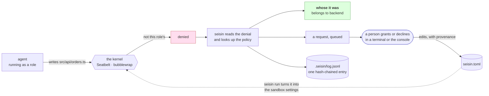

# seisin

[](https://github.com/carlostapiacl/seisin/actions/workflows/test.yml)
[](https://scorecard.dev/viewer/?uri=github.com/carlostapiacl/seisin)
[](https://www.npmjs.com/package/seisin)
[](https://github.com/carlostapiacl/seisin/blob/main/LICENSE)
[](https://github.com/carlostapiacl/seisin/blob/main/package.json)
[](https://github.com/carlostapiacl/seisin/blob/main/package.json)

> **seisin** *(n.)*: the legal possession of a piece of land, held by whoever is standing on it.

**Give each AI agent its own folders and its own keys.** The kernel enforces it, and when it denies something, seisin tells you *whose* file it was.


```bash
npm install -g seisin                  # on Linux, three system packages first: see Install
seisin init && seisin check            # propose a policy from the repo, then read it
seisin run <role> -- claude -p "…"     # the roles are the ones seisin check lists
```

**Before you install:** by default a role can still read your home directory, `~/.ssh`, `~/.aws`
and `~/.config` included. seisin closes the keys you declare, not every credential on the machine.
To close the rest, set `[runtime] isolate = "credentials"` ([how it protects secrets](#how-it-protects-secrets)).

**Is it for me?** If two or more agents work in one repository, yes. With one agent, its own
sandbox covers most of this ([what is left over](#what-it-is-for)).

**[The short version, with the demos playing →](https://carlostapiacl.github.io/seisin/)** · this page is the long one.

<details>
<summary><b>Contents</b></summary>

[What it does](#what-it-does) · [Sixty seconds](#sixty-seconds) · [Why this exists](#why-this-exists) · [What it is for](#what-it-is-for) · [Install](#install) · [Use](#use) · [Configure](#configure) · [Day one](#what-will-look-like-a-bug-on-the-first-day) · [Agents](#which-agents-it-has-been-run-with) · [The first policy](#where-the-first-policy-comes-from) · [Requests](#when-it-says-no-it-leaves-a-request-behind) · [Secrets](#how-it-protects-secrets) · [The log and the console](#the-log-the-console-and-your-assistant) · [How it holds](#how-it-holds) · [Scratch space](#scratch-space-and-what-it-costs) · [Prior art](#prior-art) · [Status](#status)

**Deeper:** [Configure in full](https://github.com/carlostapiacl/seisin/blob/main/docs/configure.md) · [Keys](https://github.com/carlostapiacl/seisin/blob/main/docs/keys.md) · [Requests](https://github.com/carlostapiacl/seisin/blob/main/docs/requests.md) · [Log, console, MCP and walls](https://github.com/carlostapiacl/seisin/blob/main/docs/log.md) · [Sandboxes](https://github.com/carlostapiacl/seisin/blob/main/docs/sandboxes.md) · [Runs for a launcher](https://github.com/carlostapiacl/seisin/blob/main/docs/runs.md) · [Agents](https://github.com/carlostapiacl/seisin/blob/main/docs/agents.md) · [Day one](https://github.com/carlostapiacl/seisin/blob/main/docs/first-day.md) · [Scratch](https://github.com/carlostapiacl/seisin/blob/main/docs/scratch.md) · [JavaScript API](https://github.com/carlostapiacl/seisin/blob/main/docs/api.md) · [Prior art](https://github.com/carlostapiacl/seisin/blob/main/docs/prior-art.md) · [Glossary](https://github.com/carlostapiacl/seisin/blob/main/docs/glossary.md) · [What it has been put through](https://github.com/carlostapiacl/seisin/blob/main/docs/what-it-has-been-put-through.md) · [Field notes](https://github.com/carlostapiacl/seisin/blob/main/docs/field-notes.md) · [Decisions](https://github.com/carlostapiacl/seisin/blob/main/docs/decisions.md) · [Contributing](https://github.com/carlostapiacl/seisin/blob/main/CONTRIBUTING.md)

</details>

## What it does

seisin is a permission layer on top of a sandbox. The OS does the isolation. seisin adds what the OS cannot know: which role a path belongs to, and so who to ask next.

Five reviews looked for ways past the boundary: [what they found and what is still open](https://github.com/carlostapiacl/seisin/blob/main/docs/what-it-has-been-put-through.md). What running four teams of agents behind it cost is in the [field notes](https://github.com/carlostapiacl/seisin/blob/main/docs/field-notes.md).



**The kernel says no. seisin says whose.** Other permission layers answer *yes* or *no*, or
which rule said no. A denial that names an owner turns a dead end into a handoff.

```
$ seisin run frontend -- sh -c 'echo // fix >> src/api/orders.ts'
seisin: frontend · writes src/web/** public/** (+6 scratch) · keys netlify-token.txt · runs no agent seisin knows · env 20 kept, 58 dropped · read all
sh: src/api/orders.ts: Operation not permitted
seisin: 1 kernel denial(s) recorded

    #1  frontend wants write on src/api/** (owned by backend)
        first asked over src/api/orders.ts
        id frontend:write:src/api
        handed to backend

  this run: 1 new request(s) — seisin requests
```

The first line is the run's own header: what this role may write, which keys it holds, and how
much of your environment it did not inherit. The last lists only what this run filed; the
rest of the queue is one count, and `seisin requests`.

The line under the request says where it goes: *handed to backend*, or *a person decides* when
nobody or several roles own the path. seisin does not start backend; whatever launches your agents
reads that decision and runs `seisin run backend --handoff frontend:write:src/api`
([where a request goes](https://github.com/carlostapiacl/seisin/blob/main/docs/requests.md#where-a-request-goes),
and [denials a caller expects](https://github.com/carlostapiacl/seisin/blob/main/docs/requests.md#a-denial-the-caller-expects)).

The kernel denies; the name comes from the policy. `Operation not permitted` is all the boundary itself says, so seisin reads the denial from the kernel's log and looks up the owner. On Linux only the hook can do that; [the ask is upstream](https://github.com/carlostapiacl/seisin/blob/main/docs/upstream/cli-violations.md) as [issue #582](https://github.com/anthropics/sandbox-runtime/issues/582).

The agent can ask directly too, from inside the sandbox:

```
$ seisin run frontend -- seisin whose src/api/orders.ts
seisin: frontend · writes src/web/** public/** (+6 scratch) · keys netlify-token.txt · runs no agent seisin knows · env 20 kept, 58 dropped · read all

  src/api/orders.ts belongs to backend
  you are frontend. It is handed to backend: hand it over rather than working around it.
```

The second line is the same handoff decision the queue shows. The hook's denial and the note after
a failed command say it the same way.

## Sixty seconds

```bash
npm install -g seisin
cd your-repo
seisin init                            # proposes a policy from what the repo already says
seisin check                           # read it before you trust it
seisin wire                            # let the agent record what it does
seisin run <role> -- claude -p "…"     # a role from seisin check, inside its own territory
```

On Linux, [three system packages first](#install). Everything below is why it works and where it does not.

---

## Why this exists

Two things are true about how agents are kept in bounds today, and both are in the official docs.

**1. Permission rules match text, not behaviour.** From the Claude Code documentation:

> Calls matching `rm *` **as written** are denied […] Other `Bash` calls, **including `/bin/rm`**, fall through to the permission mode.

A rule is a string comparison against a command someone might not spell that way. A child process does not spell it at all.

**2. The tools that *do* ask the OS don't know who anyone is.** They take one global policy. That is fine for one agent. Once you run two (separate worktrees, a frontend agent and a backend agent, a hotfix agent and a sprint agent), "may this be written?" is the wrong question. The right one is **"whose is it?"**

`seisin` answers the second question and hands the first one to the operating system.

```
   ONE GLOBAL POLICY                     WHOSE IS IT?

   frontend ──┐                          frontend ──► src/web/**    ok
              ├──► may this be written?  backend  ──► src/api/**    ok
   backend  ──┘           yes
                                         frontend ──► src/api/**    no
   two agents, one answer,                    belongs to backend
   the whole repo, all the time               → hand it over, do not work around it
```

## What it is for

**It contains an agent's mistakes. Against a hostile agent, the guarantee is the one of the
sandbox you run it under.** Five reviews went looking for ways past the boundary;
[what they found and what is still open](https://github.com/carlostapiacl/seisin/blob/main/docs/what-it-has-been-put-through.md).

**It holds against an agent that is wrong:** one that edits a file it was not asked about, reads
another role's key, or calls an API nobody declared. The kernel denies however the command was
spelled. Verified against a grandchild process, an absolute path, a symlink, `python -c`, and a
shell redirect.

**Against an agent that is trying, the line is drawn by the sandbox.** seisin writes the
policy and checks that the sandbox can hold it; [the sandbox you choose](https://github.com/carlostapiacl/seisin/blob/main/docs/sandboxes.md)
enforces it. Some limits are the policy's and hold under any sandbox, measured in this repo's
own fixtures:

| | |
|---|---|
| with the default read mode (`read = "all"`) it can read everything except the declared key directories, **including `~/.ssh`, `~/.aws`, `~/.npmrc` and `~/.config`** | by design: an agent that cannot read the repo cannot work. `read = "territory"` closes those homes (as does `[runtime] isolate = "credentials"`); `seisin scan` finds secrets stored elsewhere |
| it can write anything inside its own territory | including staging an exfiltration |
| `base64` defeats the redaction | only the literal value is masked, and only on stdout and stderr |
| an allowed domain is an allowed channel | if the agent's own API is reachable, so is everything that goes through it. [`[network] deny_addresses`](https://github.com/carlostapiacl/seisin/blob/main/docs/configure.md) keeps an allowed name from resolving into your LAN |
| the hook is text-based and evadable | on purpose: what escapes the hook still hits the kernel, which denies. On macOS [the kernel's own denials are recorded](https://github.com/carlostapiacl/seisin/blob/main/docs/log.md#seeing-what-happened); on Linux they are not. Attribution is not a control |

Others are the sandbox's, and differ between the two built in:

| | `tartaros` (the default) | `srt` |
|---|---|---|
| a process the agent leaves running | **macOS:** the run's process group is killed; one that calls `setsid` outlives it (measured 2026-10-16). **Linux:** the run's cgroup is killed whole (read from its source) | **macOS:** it outlives the run, whether it double-forks, ignores signals under `nohup` or calls `setsid` (measured 2026-10-16). **Linux:** the PID namespace ends with the run (read from its source) |
| deleting inside the territory | not measured here | write includes delete; the ask is upstream as [issue #545](https://github.com/anthropics/sandbox-runtime/issues/545) |
| `[network] deny_addresses` | not yet: a role that has it runs under `srt` where it is installed, and `check` says why | enforced |
| `local_binding = true` | refused (it grants ports one at a time): a role that has it runs under `srt` where it is installed | enforced |
| `local_ports`, a client that skips the proxy (a database driver) | reaches the listed port: the kernel grants it | denied: only a client that honours the proxy gets there |
| what it is | by the author of seisin, alpha | Anthropic's, described by its authors as a research preview |

`seisin check` says which sandbox each role gets before anything runs.

It is for several of your own agents, on your own machine, getting in each other's way. For an
agent you do not control, choose the sandbox for that threat: seisin does not make its guarantee
stronger.

It does not schedule agents or merge their work (it runs one command as one role), and it does not
manage secrets (it scopes reads of files you already have). With **one** agent, *whose file is
this* has one answer: turn on your agent's own sandboxing first; Claude Code has it built in, over
the same runtime. What seisin still adds for one agent is narrow. The environment is built rather
than inherited (measured on one machine: **15 variables kept, 60 dropped**, among them
`GITHUB_TOKEN` and the AWS pair), the declared key directory is denied to every process, and the
network allowlist covers the whole process rather than one tool. It was designed for two agents
or more.

## Install

```bash
npm install -g seisin
```

That pulls in [tartaros](https://github.com/carlostapiacl/tartaros), the default sandbox, prebuilt for macOS and Linux: Seatbelt on macOS, Landlock and seccomp on Linux. No containers, no VMs, no daemon, and no other dependency. [`@anthropic-ai/sandbox-runtime`](https://github.com/anthropics/sandbox-runtime) (`srt`) is used where you install it apart, after tartaros: for a role tartaros cannot hold (a blanket `local_binding`, `deny_addresses`, a Linux host without Landlock), or anywhere `[sandbox] provider` names it. A sandbox of your own can enforce too ([docs/sandboxes.md](https://github.com/carlostapiacl/seisin/blob/main/docs/sandboxes.md)).

```bash
npm install -g @anthropic-ai/sandbox-runtime@0.0.81   # optional: srt, for what tartaros cannot hold
```

**For srt on Linux you also need three system packages.** Without them srt refuses to start
rather than run unconfined:

```bash
apt install bubblewrap ripgrep socat      # or your distro's equivalent
```

**On Ubuntu 24.04 and newer**, unprivileged user namespaces are off by default. tartaros
runs without them (with the limits in its docs/limits.md); bubblewrap, and so srt, needs one.
Every srt run dies with `bwrap: No permissions to create new namespace`:

```bash
sudo sysctl -w kernel.apparmor_restrict_unprivileged_userns=0
```

When this happens seisin seems to deny everything, because the sandbox never starts. Editing
`seisin.toml` will not fix it.

**Inside a container** bubblewrap needs to create namespaces and mount `/proc`, which a
default Docker container forbids. `--cap-add SYS_ADMIN --security-opt seccomp=unconfined`
gets namespaces; mounting `/proc` needs `--privileged`. If you cannot grant that, run
seisin on the host and let the container be what it sandboxes.

## Use

```bash
seisin init                              # proposes a seisin.toml for this repo
seisin check                             # print the map, run nothing
seisin check --system-log                # macOS: is the system log dropping denials right now?
seisin help limits                       # what seisin cannot do, in any repo
seisin run frontend -- claude -p "…"     # run an agent as that role
seisin explain frontend write src/api/x  # ask one question, exit 0 or 1
seisin review --since 7d                 # what the log says about the policy, this week
seisin wire                              # install the PreToolUse hook in this repo
seisin ui                                # a console for deciding what is waiting
seisin ui --runs <dir>                   # read only, over many runs a launcher archived (docs/runs.md)
```

**Three ways in, and they say the same thing.** The **CLI** is what a person types and what
every agent runs under. The **console** (`seisin ui`) is for a person deciding something. The
**MCP server** is for an agent asking about its own situation. A change to what any of them
says lands in all three ([CONTRIBUTING](https://github.com/carlostapiacl/seisin/blob/main/CONTRIBUTING.md#three-surfaces-and-a-change-lands-in-all-of-them)
says why, and a test holds one half of it.

`seisin <command> --help` lists a command's flags, examples and exit codes. The exit codes, so
the commands compose in a script, a pre-commit hook or CI:

| command | 0 | 1 | other |
|---|---|---|---|
| `run` | — | — | the command's own status; 86 if the canary proves the boundary does not hold; 127 if it is not on the role's PATH; 128+n when killed by signal n (130 for ctrl-c) |
| `check` | the policy can be enforced (warnings included) | a role cannot be enforced as written, `--verify` failed, or `--system-log` measured messages dropped | |
| `explain` | allowed | denied | |
| `scan` | no certain credential | a certain credential outside the key dirs | |
| `review` | no role denied repeatedly | a role denied repeatedly | |
| `walls` | no walls | walls listed | |
| `requests` | nothing pending | requests pending | |
| `log verify` | the hash chain holds | the hash chain is broken | |
| `whose`, `grant`, `decline`, `log`, `init`, `wire`, `ui`, `watch`, `mcp` | done | — | |
| `hook` | always | — | |

Every command exits **2** on a usage error (an unknown command, flag, role or action), and every
command that reads the policy exits 2 when there is no `seisin.toml` here or above.

To call it from code, the same functions are exported: [docs/api.md](https://github.com/carlostapiacl/seisin/blob/main/docs/api.md).

## Configure

One file at the root of your repo. Anything not listed is denied; there is no permissive default.

```toml
[keys]
dir = ".secrets"          # every key lives here; roles name the files they may read

[network]
allow = ["github.com", "*.github.com"]

[roles.frontend]
writes = ["src/web/**", "public/**"]
keys   = ["netlify-token.txt"]

[roles.backend]
writes   = ["src/api/**", "migrations/**"]
keys     = ["database-url.txt", "sentry-dsn.txt"]
network  = ["api.stripe.com"]   # this role only: it replaces [network] rather than adding
```

Private address ranges, `read = "territory"`, toolchains, `verify`, protected control files,
browsers, local ports, providers and the sandbox per role:
**[docs/configure.md](https://github.com/carlostapiacl/seisin/blob/main/docs/configure.md)**.
`seisin init` proposes a first policy from what the repo already says
([where the first policy comes from](#where-the-first-policy-comes-from)).

## What will look like a bug on the first day

Shapes a correct policy still produces that read as breakage: a granted file whose
neighbours are not granted, a lock file in somebody else's repository, a worktree that is two
paths for one repository, a tool that reports a denied write as a *readonly database*, and Go
or Dart failing TLS on macOS with the domain allowed. The first four came out of one
production window where none of them was the boundary misbehaving.

One more comes with protected files: **a role's `git checkout`, `pull` or `rebase` cannot update
a file the role may not write.** Git exits 0, the branch moves, and the old `.vscode/settings.json`
stays behind as a modification, which a later `commit -a` would turn into a revert. Switch
branches outside the sandbox, or hand that role the family if keeping those files is its job.

**[What each one looks like, and what to do →](https://github.com/carlostapiacl/seisin/blob/main/docs/first-day.md)**

## Which agents it has been run with

Four: Claude Code, opencode, codex and a LangGraph script, each against a real policy with
the boundary applied. gemini 0.57.0 has only been started under it,
which is not the same claim.

**An agent that sandboxes itself has to be told to stop.** `codex` confines every command it runs, and no OS applies a second profile to a
process that already has one. seisin says so before it starts one, because the error you get
otherwise names neither seisin, nor the agent, nor the fix.

**[Every agent, its version, what it needed, and how each reacted to being stopped →](https://github.com/carlostapiacl/seisin/blob/main/docs/agents.md)**

## Where the first policy comes from

Every permission tool dodges this question. Written by hand, the first policy is a guess, and
the first unjustified denial is when the tool gets uninstalled. So don't write it: watch, then
write:

```bash
seisin wire                                      # the hook is what records
seisin run frontend --observe -- claude -p "…"   # the repo opens, the network does not
seisin init --from-observations                  # writes seisin.toml.observed
```

What `--observe` changes: the whole repo is writable for that run, so a write outside the
territory is recorded instead of refused. What it does not: the key directories, the policy and
`.seisin/` stay denied, and so does every domain not on the allowlist. What gets recorded is what
the hook sees: the tool calls of an agent (Claude Code, Codex…) in a repo where `seisin wire` ran.
A plain shell command (`--observe -- npm test`) goes through no hook and records nothing.

It lands as `.observed`, not as your config. A policy generated behind your back is not a
policy: diff it, then move it.

## When it says no, it leaves a request behind

A tool that only says no gets its policy widened until nobody reads it. So a denial leaves
something to act on, and many denials in one directory are **one** request:

```
$ seisin requests

  1 pending request(s)

    #1  frontend wants write on src/api/** (owned by backend) · asked 3×
        first asked over src/api/orders.ts
        id frontend:write:src/api

    seisin grant <n|id> [--reason "…"]   ·   seisin decline <n|id> [--reason "…"]
    #n is a position and shifts as requests are settled; the id does not.
```

The grant writes its own provenance next to the line it adds:

```
$ seisin grant 1 --reason "frontend owns checkout now"

  granted  frontend → src/api/**
  written into /path/to/repo/seisin.toml with its provenance. It applies on the next run.
```

```toml
[roles.frontend]
writes = ["src/web/**", "public/**",
  "src/api/**"   # granted 2026-09-12 · asked 3× · «frontend owns checkout now»
]
```

**Granting is never a tool call.** An agent can read the queue and draft the change; only a
person applies it, in a terminal or in the console. The MCP server is read-only for that reason.

With [`[notify]`](https://github.com/carlostapiacl/seisin/blob/main/docs/configure.md#notifications) a person gets one message per new request (ntfy, Slack or any webhook), and
`seisin wire` lets the hook tell the agent whose a path was before and after it is denied.

**[How a denial becomes a request, why it deduplicates, and what a grant records →](https://github.com/carlostapiacl/seisin/blob/main/docs/requests.md)**

## How it protects secrets

Six ways a secret leaves a process. seisin closes four by default, one when you turn it on, and
one not at all.

| way out | closed by |
|---|---|
| reading another role's key file | the kernel: the key directory is denied, each declared key re-allowed |
| a key riding in the environment | the launcher: the child's environment is **built, not inherited** |
| spilling a key the role does hold | the launcher: masked on stdout and stderr, even split across buffers |
| sending it somewhere | the kernel: egress is allow-only, by hostname. HTTP(S) works; [SSH does not on macOS](https://github.com/carlostapiacl/seisin/blob/main/docs/decisions.md#ssh-does-not-work-and-it-is-not-seisin-that-decided-that) |
| **credentials in your home** (`~/.ssh`, `~/.aws`, `~/.npmrc`, `~/.config`) | **not by default** (`read = "all"`). `[runtime] isolate = "credentials"` closes them and the agent stays logged in; `read = "territory"` closes more |
| **a key stored outside the declared directories** | **nothing.** `seisin scan` finds them so you know |

```toml
[keys]
dir = [".secrets"]

[roles.frontend]
key_mode = "env"
keys = ["netlify-token.txt",                       # a file the role may read
        "TOKEN=file://.secrets/all.env#NETLIFY",   # one value, and no read at all
        "OP=op://vault/item/field"]                # anything that prints a secret
```

A **provider** is a command with a `{ref}` placeholder, so adding 1Password, Bitwarden or
`sops` is TOML and not code. `file://` ships built in. The parent resolves, never the
confined process. Nothing degrades: a provider that fails stops the run.

A key reaches the role as a variable (`key_mode = "env"`), as a file in the run's private
directory (`"run-file"`), or not at all (on Linux, and on macOS under tartaros): with `"inject"` the agent holds a
placeholder and the sandbox swaps in the real value only on the way to the hosts you list for
it. That costs terminating TLS to those hosts, which `seisin check` names, and a host that
stores what it is sent can still hand the value back, so use a least-scope token.

**[Key directories, references, providers, delivery modes and nine recipes →](https://github.com/carlostapiacl/seisin/blob/main/docs/keys.md)**

For agents you would not trust with your machine, `[runtime] read = "territory"` denies the places
data lives (homes, temp directories, volumes) and leaves each role its repo, its territory and
a toolchain it declares, which `seisin check --verify` proves it can run. Every run, in every
mode, starts with a canary that tries the policy from inside and refuses to start the agent if
it does not hold. **[What it closes, what it costs →](https://github.com/carlostapiacl/seisin/blob/main/docs/scratch.md#reading-only-what-the-role-needs)**

**Measured, over four teams of agents and three days: every denied read was a read of something
the policy had declared a key.** 148 of them, no exceptions, from five roles, all running
searches that swept a repository root. That is how a key gets read without anyone deciding
it should. ([The measurement, ~370 confined runs over one production window →](https://github.com/carlostapiacl/seisin/blob/main/docs/keys.md))

## The log, the console and your assistant

```bash
seisin log --verdict denied      # what the agents tried and could not do
seisin review --since 7d         # where the policy was wrong, from what happened
seisin walls dev                 # what a role keeps being denied, and what it cost
seisin ui                        # a console for the person deciding
```

One append-only, hash-chained JSONL under `.seisin/`, which no role can write. `review` finds
denials that repeat (a policy that is wrong) and grants never used (the only evidence for making a
policy smaller). The MCP server (`seisin mcp`) is read-only and answers an agent's questions about
its own situation. **[The log, `review`, the console, the MCP server and walls →](https://github.com/carlostapiacl/seisin/blob/main/docs/log.md)**

## How it holds

| layer | what it does | can it be talked around? |
|---|---|---|
| your agent's `allow`/`deny` rules | match the command string before it runs | yes: `/bin/rm`, a heredoc, a child process |
| **seisin** | decides what to ask for, and names the owner | it doesn't enforce, it explains |
| **the sandbox → Seatbelt / bubblewrap / Landlock** | the OS denies the syscall | no |

```
   Write tool · Bash `rm -rf` · /bin/rm · python -c "open(…)" · a grandchild
                                │
                                │  however it was spelled, it arrives as one syscall
                                ▼
                             KERNEL
                                │
                                │  against the policy `seisin run` installed
                                ▼
                     inside this role's territory?
                          │                  │
                         yes                 no
                          │                  │
                          ▼                  ▼
                        done         Operation not permitted
                                             │
                                             │  and, on a separate path, the hook
                                             ▼
                                    "belongs to backend"
                                    explanation — never the boundary
```

tartaros is the default enforcer, not the only one. `[sandbox] provider` picks another
(`srt`, or any sandbox declared as a command) per role, and only where it enforces the whole
policy: see [docs/sandboxes.md](https://github.com/carlostapiacl/seisin/blob/main/docs/sandboxes.md).

That split keeps seisin small. Because the kernel is the boundary, seisin does not have to be airtight, only *legible*. A leaky explainer costs you a confusing log line. A leaky enforcer costs you the repo.

Verified by the test suite, which runs real commands in a real sandbox:

```
✔ a role reads the key it declares
✔ a role cannot read another role's key
✔ each role reads its own, so the deny is not just blanket
✔ a role writes inside its territory
✔ a role cannot write outside it
✔ reading another role's code still works
✔ the boundary survives a grandchild process
✔ an absolute path does not walk around the rule
```

## Scratch space, and what it costs

Territory alone is correct and unusable: an agent writes session state under its own config
directory and its tools write to the temp dir, so *your folders and nothing else* stops the
agent from starting. Every role gets `~/.cache`, `$TMPDIR` and `/tmp`, and a run of Claude Code
or Codex gets that agent's own directory (`~/.claude`, `~/.codex`), never the other's, nor the
other's sign-in. Shared scratch is a real hole, because two roles share a temp directory and
territory does not hold in it. A repo that lives inside scratch (a toy repo under `/tmp`) is
writable by every role whatever its `writes` say; `seisin check` says so (*every role can write
the whole repo*), and the same for a `writes` entry whose real path is in scratch.
It is one line to turn off. The runtime's own shared temp directory, `/tmp/claude`, is never
writable: each run gets a temp directory of its own instead.

**[What that costs, and how to close it →](https://github.com/carlostapiacl/seisin/blob/main/docs/scratch.md)**

## Prior art

[tartaros](https://github.com/carlostapiacl/tartaros) is the enforcement seisin sits on, and
[`sandbox-runtime`](https://github.com/anthropics/sandbox-runtime) the one it was built on.
OpenShell, hazmat and nono isolate the agent from your machine; containers and microVMs isolate a
process from the host. seisin separates roles from each other inside one repository, and names the
owner when the kernel denies something. They compose: the agent seisin confines can run inside any
of them. **[Each one, and why not a container →](https://github.com/carlostapiacl/seisin/blob/main/docs/prior-art.md)**

## Status

CI runs the full suite on macOS and `ubuntu-latest`, Node 18/20/22/24, on every pull request and
push to `main`. On 2026-11-06, on Node 24: macOS **1215 tests, 1205 passing, 10 skipped**;
Linux **1214, 1185 passing, 29 skipped**. The skips are platform tests; the job fails if the 26
core boundary tests in `test/sandbox.test.js` skip. A release is published only from CI, after
that passes, with npm provenance. [Which claim was measured where](https://github.com/carlostapiacl/seisin/blob/main/docs/what-it-has-been-put-through.md#where-each-claim-was-actually-run),
and [what running agents behind it cost](https://github.com/carlostapiacl/seisin/blob/main/docs/field-notes.md).

The config format may still change before `1.0`; `seisin check` will say what changed.

**Still open:**

| | |
|---|---|
| **Windows** | the runtime has a backend. seisin has never been pointed at it, and no CI runner covers it |
| **Deleting inside your own territory** | the sandbox's to enforce, and `srt` cannot: write includes delete. The ask is upstream as [issue #545](https://github.com/anthropics/sandbox-runtime/issues/545), open and unanswered since 2026-09-13, [with the measurement behind it](https://github.com/carlostapiacl/seisin/blob/main/docs/upstream/denyUnlink.md) and [a demo](https://github.com/carlostapiacl/seisin/tree/main/docs/demo/) |
| **`init` heuristics** | it reads `.claude/agents/`, then `CODEOWNERS`, then the top-level folders that hold code. Every other convention is a guess nobody has made yet |
| **SSH inside a run (macOS)** | on macOS the `ProxyCommand` the runtime sets can't authenticate to its own proxy, so `git` over SSH fails at the handshake (on Linux the runtime routes it through an authenticated proxy — read from its source, not measured here). Fix upstream: [PR #516](https://github.com/anthropics/sandbox-runtime/pull/516). Use an HTTPS remote |
| **A browser inside a role (macOS)** | headless Chromium runs with `browsers = ["chromium"]`. Not covered yet: Chrome and Chrome for Testing, and `@playwright/mcp` under srt (it runs under tartaros). [docs/browsers.md](https://github.com/carlostapiacl/seisin/blob/main/docs/browsers.md#what-is-not-covered-yet) |

Each term has one meaning, listed in [the glossary](https://github.com/carlostapiacl/seisin/blob/main/docs/glossary.md): the boundary
**denies**, a person **grants** or **declines**, seisin **refuses** a config it cannot enforce.

Issues and pull requests are welcome. [CONTRIBUTING.md](https://github.com/carlostapiacl/seisin/blob/main/CONTRIBUTING.md) asks mainly that a claim come
from something measured. If you are reporting something that got past the boundary, do it
[privately](https://github.com/carlostapiacl/seisin/blob/main/SECURITY.md); `seisin log --verdict denied` and the `seisin.toml` are the two
things that make it reproducible.

I write up what I measure running agents behind it at [carlostapia.cl](https://carlostapia.cl/notes/).

## License

MIT
